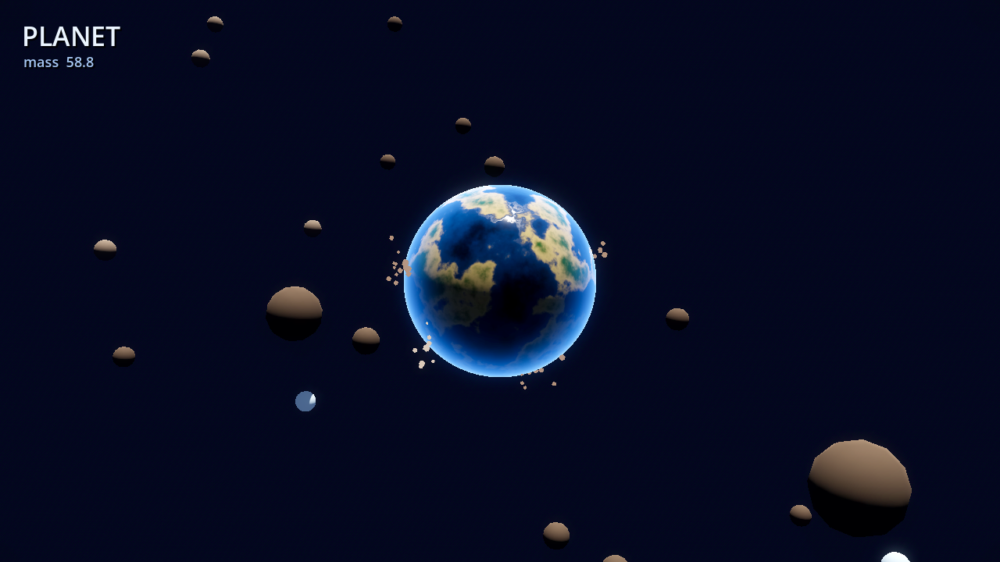
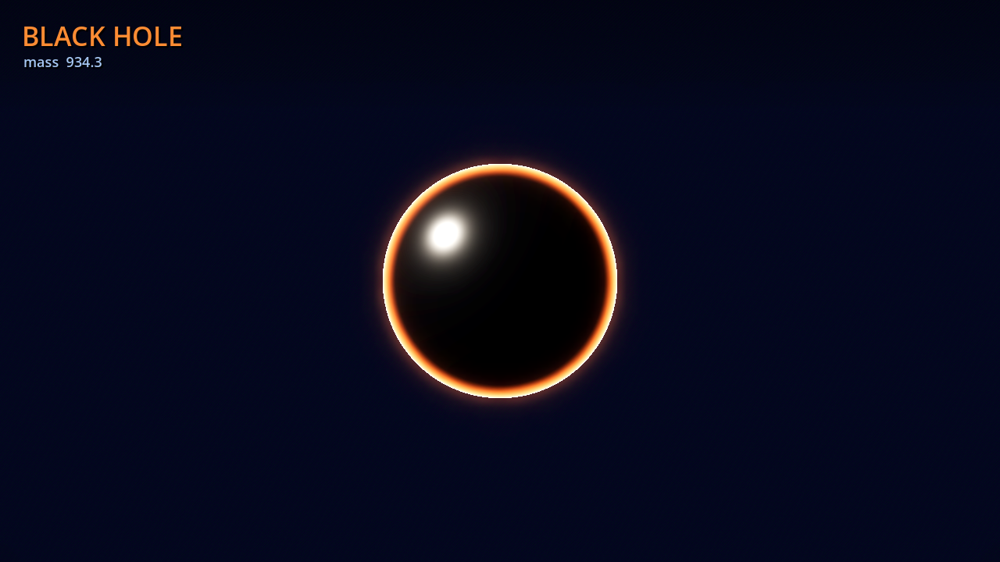

# Planet — 大鱼吃小鱼的星球演化游戏

太空版「大鱼吃小鱼」：从一颗小陨石开始，靠引力吸收周围的碎石不断长大，
依次演化 **陨石 → 流星 → 行星 → 恒星 → 白矮星 → 黑洞**。
成为黑洞后，整片星域都会被吞进去。

支持 **桌面（键鼠）** 与 **手机（触屏摇杆）** 两种操作，UI 按屏幕尺寸自动缩放。

| 行星阶段 | 黑洞终局 |
|---|---|
|  |  |

## 运行

```bash
# 编辑器
Godot_v4.7.2-stable_win64.exe --path projects/planet -e

# 直接运行
Godot_v4.7.2-stable_win64.exe --path projects/planet

# 模拟手机分辨率
Godot_v4.7.2-stable_win64.exe --path projects/planet --resolution 390x844
```

## 操作

| 平台 | 操作 |
|---|---|
| 桌面 | `WASD` / 方向键移动（方向相对于镜头朝向），**按住左键拖动**旋转视角 |
| 手机 | 屏幕**左半边**按住拖动 = 虚拟摇杆；**右半边**拖动 = 旋转视角 |
| 通用 | `Esc` 退出，死亡后 `R` 重开 |

## 玩法

- 靠近比你**小**的碎片会把它吸进来，质量增加。
- 撞到比你**大**的碎片会掉质量；掉到 0.4 以下且还在陨石阶段就结束。
  掉血量与体型差成正比，只是稍大一点的石头只会磕掉一点，不会秒杀。
- 大小接近（差距 < 1.12 倍）的会互相弹开。
- 质量跨过阈值就进入下一演化阶段，外观与 HUD 同步变化。

### 演化阶梯

| 阶段 | 名称 | 质量阈值 |
|---|---|---|
| 0 | Asteroid 陨石 | 0 |
| 1 | Meteor 流星 | 8 |
| 2 | Planet 行星 | 45 |
| 3 | Star 恒星 | 160 |
| 4 | White Dwarf 白矮星 | 420 |
| 5 | Black Hole 黑洞 | 900 |

### 掠夺者（Rival）

场上还有和你竞争的其它天体，各有颜色（锈红 / 琥珀 / 紫 / 青 / 品红）：

- 它们也会吞碎片长大，同样能演化到黑洞。
- 它们会**主动追杀**比自己小的目标（包括你），并**逃离**比自己大的。
- 你比它大 → 撞上去可以吞掉它，一次性获得大量质量。
- 它比你大 → 撞上去会被它吞掉。
- 开局有保护期：玩家质量达到 6 之前不会刷掠夺者，
  且开局碎片全部可吃，保证每次都有起跑空间。

## 移动端适配

- 渲染器切到 `mobile`（Forward Mobile），`project.godot` 里已配置。
- 相机 `keep_aspect = KEEP_WIDTH`（在 `camera_rig.gd` 里设置），竖屏手机能看到和横屏桌面一样的横向视野。
- HUD 按 `min(屏宽, 屏高) / 720` 缩放，字号与边距在手机上自动收小。
- 触屏摇杆只在实际有触摸屏的设备上显示，桌面端不出现；摇杆占左半屏，右半屏留给视角旋转，两边各自按 `index` 跟踪，互不干扰。
- 屏幕左上角的 `II` 按钮暂停。

### 导出

`export_presets.cfg` 已预置两个预设：

- **Android** → `build/planet.apk`（包名 `com.goodbj.planet`，arm64）
- **Web** → `build/web/index.html`

导出 Android 需要先装 Android SDK + JDK，并在 Godot 编辑器里配置路径：

```bash
# 装好后命令行导出
Godot_v4.7.2-stable_win64_console.exe --headless --path projects/planet \
  --export-debug "Android" build/planet.apk
```

Web 导出不需要额外 SDK，可直接在手机上用浏览器打开测试。

## 实现要点

### 星球外观：全程序化着色器

`shaders/planet.gdshader` 一个着色器覆盖全部六个阶段，靠 `stage` uniform 切换：

- **3D 值噪声 + FBM** 在球面方向上采样，生成无缝的大陆/海洋分布。
- 高度值走颜色渐变：深海 → 浅海 → 沙滩 → 草地 → 森林 → 岩石 → 雪。
- **阶段覆盖**：
  - 陨石/流星：裸岩 + 陨石坑（噪声做环状凹陷）
  - 恒星：颗粒状对流 + 临边昏暗（limb darkening），避免渲染成一坨死白
  - 白矮星：蓝白高频噪声 + 强临边昏暗
  - 黑洞：黑色圆盘 + 边缘吸积盘辉光（`rim^7` 做锐利光环）
- 大气辉光用 fresnel 边缘光近似，不需要额外壳层几何体。
- `tint` / `heat` 两个 uniform 给掠夺者染色并在追击时发红光，玩家和掠夺者共用同一个着色器。

### 镜头与生长（CameraRig）

- 半径 `base + sqrt(mass) * k`，`sqrt` 让前期成长感明显、后期不至于爆炸。
- 镜头由 `scripts/camera_rig.gd` 统一管理：以玩家为中心的**球坐标环绕相机**，
  距离随半径线性拉远（`radius * 6.5 + 9`），任何阶段都在画面内。
- `yaw`（环绕）由鼠标拖动 / 触屏右半屏拖动控制；`pitch` 限制在 **6°~78°**：
  低于 6° 会穿到碎片平面下方，还会把天空的地平线接缝切进战场。
- **移动方向相对于镜头朝向**：`planet.gd` 调 `camera_rig.input_to_world(input)`
  把屏幕输入映射到地面平面，转视角之后「上」依然是屏幕里的前。
- 相机 `keep_aspect = KEEP_WIDTH` 也挪到了 rig 里，桌面/竖屏手机视野一致。

### 引力与吞并

- `world.gd` 每帧对每块碎片施加指向玩家的力，强度按距离衰减，`gravity_radius` 外失效。
- 碰撞判定不靠物理引擎，而是**手动算距离**：`dist < planet_radius + debris_radius` 即接触。
  规则明确、不依赖碰撞层配置，也避免刚体互弹的抖动。
- 吞并条件 `大的 >= 小的 * 1.12`：必须明显更大才能吃。

### 黑洞终局

质量到 900 后进入黑洞阶段，`world._consume_everything()` 接管：
全场碎片与掠夺者被强力拖向玩家并逐个吞掉，直到星域清空。

## 开发辅助

只在带命令行参数时激活，正常运行无影响：

```bash
# 截取某个演化阶段的画面
... --path . -- --stage=3 --shot --shot-path=E:/out.png

# 从指定角度截图（验证环绕镜头；--capture-at 调整等待秒数）
... --path . -- --stage=3 --shot --yaw=135 --pitch=55 --shot-path=E:/out.png

# 操作映射自测：模拟按四个方向，检查移动方向是否跟随镜头朝向
... --headless --path . -- --dirtest
... --headless --path . -- --dirtest --yaw=135   # 先把镜头转 135° 再测

# 玩法自测：自动吃 18 秒，报告质量增长和阶段变化
... --path . -- --selftest

# 60 秒平衡性测试：报告存活、峰值质量、阶段序列
... --path . -- --selftest-long

# 换随机种子（默认 1729，固定种子才可比）
... --path . -- --selftest --seed=4321

# 强制刷出掠夺者，方便看外观
... --path . -- --stage=3 --show-rival --shot --shot-path=E:/out.png
```

`--dirtest` 的输出（镜头转到 135° 后依然全绿，说明移动是镜头相对的）：

```
[dirtest] yaw=135.0
[dirtest] ui_up: PASS  forward=1.00 right=0.00
[dirtest] ui_down: PASS  forward=-1.00 right=0.00
[dirtest] ui_right: PASS  forward=-0.00 right=1.00
[dirtest] ui_left: PASS  forward=-0.00 right=-1.00
[dirtest] RESULT: PASS
```

`--selftest-long` 的输出：

```
[selftest] seed=1729
[selftest] start mass=1.00 duration=60s
[selftest] end mass=1861.28 peak=1861.28 grew=true stages=[1, 2, 3, 4, 5]
[selftest] debris=0 rivals=0 rivals_seen=2 note=survived
[selftest] RESULT: PASS
```

自测机器人会像个正常玩家那样玩：躲开能吞掉自己的掠夺者、去追比自己小的掠夺者。
随机数默认按固定种子（1729）初始化，世界布局和掠夺者刷新因此可复现 ——
不加种子时同一份代码会随机红，等于没有检查。

判定看 `grew` / `stages` / `note=survived`，不要盯具体质量：headless 的帧间隔不固定，
同一份代码的 `end mass` 每次会波动（18 秒实测 106 / 231 / 806 都出现过）。

### 一条命令跑完所有检查

上面的开关全部封在 `ai/scripts/run_checks.py` 里（4 个 dirtest 角度 + 18s 玩法 +
60s 平衡 + 6 个阶段截图），改完代码跑它就能拿到绿/红，截图落在 `build/shots/`（已忽略）：

```bash
python ai/scripts/run_checks.py          # 全部，约 2 分钟
python ai/scripts/run_checks.py --quick  # 只跑逻辑检查，约 35 秒
```

## 文件结构

```
projects/planet/
├── project.godot
├── export_presets.cfg      # Android + Web 导出预设
├── scenes/
│   ├── main.tscn           # 根场景：环境、灯光、相机
│   └── planet.tscn         # 玩家星球
├── scripts/
│   ├── main.gd             # 组装世界、FX、触屏、相机 rig、重开
│   ├── planet.gd           # 玩家：移动、生长、阶段
│   ├── camera_rig.gd       # 环绕相机：yaw/pitch 拖拽、随体型拉远、输入→世界方向
│   ├── rival.gd            # 掠夺者 AI：追击/逃跑/互相吞噬
│   ├── debris.gd           # 碎片
│   ├── world.gd            # 生成、引力、吞并规则、黑洞终局
│   ├── fx.gd               # 粒子爆发、屏幕震动
│   ├── hud.gd              # 响应式 HUD、阶段横幅、威胁提示
│   ├── touch_controls.gd   # 虚拟摇杆 + 暂停
│   ├── dirtest.gd          # 操作映射自测（含 --yaw 旋转镜头后复测）
│   ├── dev_screenshot.gd
│   └── selftest.gd
└── shaders/
    └── planet.gdshader
```
